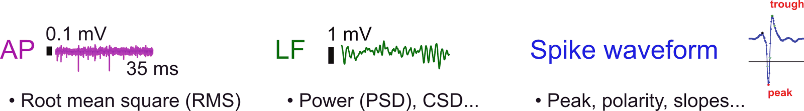

This page explains five ideas behind how ibleatools stores data and names its outputs.

## Channels and cells are two different datasets

The package works at two granularities, and they are not interchangeable.

| | Channel level | Cell level |
|---|---|---|
| One row is | One recording site on one probe | One spike-sorted unit |
| Needs spike sorting | No | Yes |
| Table | `raw_ephys_features_denoised.pqt` | `clusters.table.pqt` |
| Typical size | 384 rows per probe | Hundreds of units per probe |
| Models | Region decoders, spatial encoder | Unit encoder |

**Channel-level features are the core of the ephys atlas.** They come straight from the
voltage and need no spike sorting, which is what makes them computable on any recording
and comparable across labs. The region decoder works at this level.

{.lightbox}

Cell-level features need a spike sorting to exist first. They describe the units — their
waveforms, autocorrelograms, coupling — rather than the recording sites.

A confusing legacy detail: cell-level files are named `clusters.*` and live under
`cells_aggregates/`. "Cluster", "cell" and "unit" all mean the same thing here.

## A vintage is a coherent release

Feature definitions change. A **vintage** is a weekly label of the form `YYYY_Www`
identifying one coherent release: a set of feature definitions, plus the data computed
under them, plus the models trained on that data.

This matters because features are not stable across vintages:

- Vintage `2025_W39` **added** the spectral-parameterisation features (`aperiodic_*`,
  `decay_*`, `psd_residual_*`). Earlier vintages do not have them.
- Vintage `2025_W28` changed the **units** of `rms_ap`, `rms_lf` and `spike_count` in the
  denoised table.
- Version 0.7.0's DARTsort migration changed waveform detections by about +9.5% and
  amplitudes by about −10%.
- Version 0.9.0, first used for vintage `2026_W39`, put waveform amplitudes in **volts**,
  made `spike_count` a **rate**, and replaced the six raw waveform columns of the denoised
  table with four spike-shape columns.
- Vintage `2026_W42` renamed the first-difference CSD columns `*_csd_diff1` to `*_bpr`
  and changed the Cadzow denoising before the CSD and BPR, so their values changed too.

So a model and its features must come from the **same vintage**. The `2026_W39` region
decoder needs the spectral-parameterisation features, which a `2025_W28` feature table
lacks; run it on one and you get a `KeyError`. The `2026_W32` decoder needs the raw
waveform columns that a `2026_W39` denoised table no longer has: the same `KeyError` the
other way round. The `2026_W42` decoder asks for `rms_lf_bpr` and its siblings, which a
`2026_W39` table names `*_csd_diff1`. `read_features_from_disk` renames those, but the
values were computed with the older Cadzow denoising. A mismatch with the same column
names but different units produces no error.

Every model records its vintage, and pinning both is how you stay reproducible:

```python
model = load_pretrained(
    "int-brain-lab/ea-decoder-channel-xgboost", revision="2026_W42"
)
print(model.index["vintage"])   # 2026_W42
```

The newest feature label can run ahead of the models, so pick the model first and take
its vintage for the features. `ephysatlas.models.DECODER_VINTAGES` holds the
default vintage of each published decoder. The encoders' `predict` takes positions only,
so they have no feature vintage to match.

`FEATURES_CHANGELOG.md` records what changed in each vintage; `CHANGELOG.md` records
changes to the code.

## Projects are datasets, not vintages

An orthogonal axis. `{project}` selects *which recordings*, `{label}` selects *which
feature definitions*:

- **`ea_active`** — the default, updated weekly, tracking the latest features
- **`ibl_neuropixel_brainwide_01`** — the frozen brainwide-map dataset

Use `ea_active` for current work and the frozen project when you need a dataset that will
not move under you.

Both are downloaded through [ONE](https://int-brain-lab.github.io/ONE/), with an IBL
account. To browse the atlas without one, use the
[IBL Ephys Atlas viewer](https://ephys-atlas.iblcore.org/).

## Raw, aggregated and denoised are three different tables

The published models read only the denoised table.

```text
per-snippet features          one table per time window
        │  aggregate          median across snippets, per channel
        ▼
raw_ephys_features.pqt        one row per channel, raw units
        │  denoise            per-probe outlier suppression + transforms
        │  remap              raw waveform columns -> spike-shape columns (0.9.0 on)
        ▼
raw_ephys_features_denoised.pqt   ← what the published models consume
```

**Aggregation** exists because a single few-second snippet gives noisy per-channel
estimates. Taking the per-channel median over several windows spread through the
recording (the mean for `spike_count`) is what makes them usable — and is what the
training data did.

**Denoising** does two things. It suppresses per-channel outliers along the probe axis,
using the channel labels to know which channels to distrust (see the
[before and after](../visualise/features-along-probe.qmd#before-and-after-denoising)
figure). And it **transforms** some features:

| feature | raw | denoised |
|---|---|---|
| `rms_lf` | V (~1e-5) | dB rel. V (~−90) |
| `rms_ap` | V | dB rel. V |
| `spike_count` | count/s | log2 (count/s) |

A model trained on denoised features expects dB. Given raw volts, every column has the
right name but the wrong magnitude; no error is raised and the predicted regions are
wrong. This is why the manifest names its table explicitly:

```python
print(model.index["inputs"]["table"])   # raw_ephys_features_denoised.pqt
```

## Prediction columns have their own names

Model output columns are prefixed — `predicted_acronym`, `predicted_atlas_id` from the
decoders; `pred_<feature>` from the encoders.

Both the channel feature table and the cluster table already carry
**histology-derived** `acronym` and `atlas_id` columns. If a model returned bare
`acronym`, then:

```python
df.join(out)          # would collide
df["acronym"] = ...   # would overwrite the histology acronym
```

Namespacing makes the join always safe, and makes comparing prediction against histology a
one-liner:

```python
labelled = df.join(out)
agreement = (labelled["predicted_acronym"] == labelled["acronym"]).mean()
```

The same reasoning applies to the encoder: it predicts features whose ground-truth columns
have exactly those names, so the `pred_` prefix is what lets you compute a residual at all.

## Region maps: Allen, Beryl and Cosmos {#region-maps}

A brain region can be named at different levels of detail. The Allen atlas annotates 1,328
regions, and iblatlas groups them into coarser **region maps**, where each region is
assigned to a parent in the coarser map. ibleatools uses two of them:

- **Beryl** — 308 regions.
- **Cosmos** — 12 broad divisions, such as `Isocortex`, `HPF` (hippocampal formation),
  `TH` (thalamus) and `MB` (midbrain), plus `root` and `void`.

The published region decoders predict Cosmos regions, plus a 13th class added by
ephysatlas, `void_fluid`: the fluid-filled spaces inside the brain, such as the ventricles,
as opposed to `void` outside it. A model's `config["region_map"]` names the map its
classes come from. Remap histology labels to the same map before comparing them with a
prediction (`BrainRegions.remap` in iblatlas).

The iblatlas
[atlas mapping](https://docs.internationalbrainlab.org/notebooks_external/atlas_mapping.html)
notebook lists every map and shows how to convert between them.

## See also

- [Which brain regions is my probe in?](../tutorials/where-is-my-probe.qmd) — these ideas
  in one workflow
- [The feature pipeline](feature-pipeline.qmd) — what happens between voltage and features
- [Model families](model-families.qmd) — the four families and how they relate
- [Aggregate and denoise](../how-to/aggregate-and-denoise.qmd) — doing the middle step
- [Feature list](../reference/feature-list.qmd) — every column and its units
