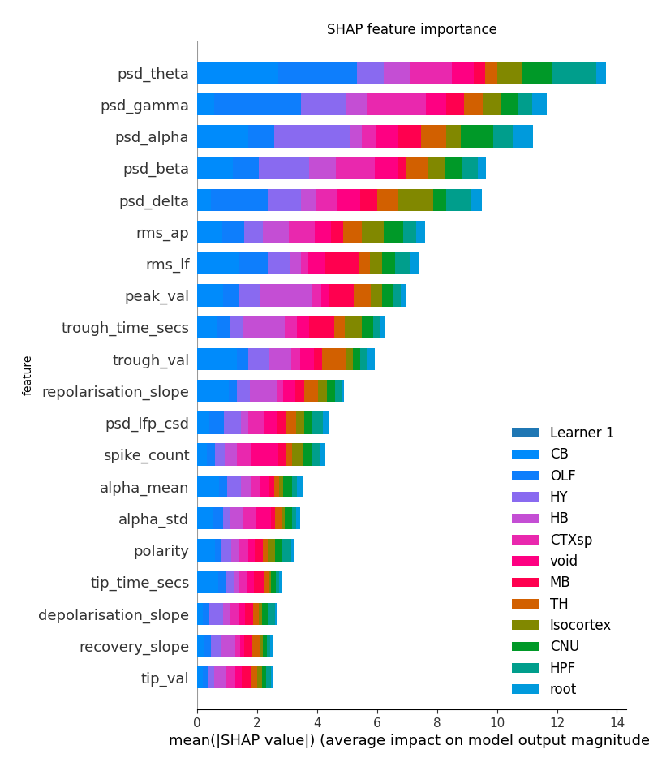

Four model families, one load path. This page explains what each family does, why they
are published differently, and how a single `load_pretrained` call serves all of them.

## The four families

| family | granularity | input | output | on the Hub |
|---|---|---|---|---|
| **Region decoder** | channel | Features | Brain region | [`ea-decoder-channel-xgboost`](https://huggingface.co/int-brain-lab/ea-decoder-channel-xgboost) |
| **Whole-probe region decoder** | channel | A probe's features, with depth | Brain region per channel | [`ea-decoder-channel-transformer`](https://huggingface.co/int-brain-lab/ea-decoder-channel-transformer) |
| **Spatial encoder** | channel | Position (`x`,`y`,`z`) | Features | [`ea-encoder-channel`](https://huggingface.co/int-brain-lab/ea-encoder-channel) |
| **Unit encoder** | unit | Position (`x`,`y`,`z`); or a unit's waveform, ACG and population coupling | Expected unit phenotype; or the unit's latent and cell type | [`ea-encoder-unit`](https://huggingface.co/int-brain-lab/ea-encoder-unit) |

### Region decoder — features in, region out

An XGBoost classifier over channel features, predicting one of 13 Cosmos-level brain
regions per channel. Five cross-validation folds plus one all-data model ship together, so
the agreement between folds (`fold_agreement`) is reported alongside the probability.

It answers "where is this channel?" from the recording alone. Its held-out accuracy is
around 0.59 across 13 classes, well above chance but far from certain, so check
[`fold_agreement`](../how-to/predict-regions.qmd#predict-with-xgboost) before relying on a prediction.

{.lightbox width=70%}

### Whole-probe region decoder — a probe in, regions out

The same question, answered for a whole probe at once. `ProbeTransformerClassifier` is a
transformer with rotary position encoding that attends across all channels of a probe,
using depth along the probe (`axial_um`) as its positional signal. A channel's prediction
can therefore use what the channels above and below it look like, which the per-channel
decoder cannot.

A release ships one model per random seed — five for `2026_W42` — so its disagreement
signal is `seed_agreement` rather than `fold_agreement`. Channels with any non-finite
feature are dropped with a warning, so its output can be a subset of the input. See
[predict regions](../how-to/predict-regions.qmd#predict).

### Spatial encoder — position in, features out

A transformer that predicts a channel's features from **where it sits in the brain**. Two
inputs: the anatomical context at those coordinates (MERFISH and AGEA gene/cell-expression
PCA volumes) and the recorded features of nearby channels on *other* probes.

{.lightbox}

It runs in the opposite direction to the decoder: it predicts what a channel at a given
position should record, so a large residual against the measured features is evidence
that a probe is not where the trajectory places it. Drawn on an
atlas slice, its predictions are a map of the brain's electrophysiology: see
[atlas maps](../visualise/atlas-maps.qmd).

Neighbours come from other probes only (`allow_same_probe: false`), so a prediction for a
probe already in the training bank does not use that probe's own features. The current
release also takes no coordinate input of its own (`use_positions: false`):
position reaches the model only through the context sampled there and the neighbours found
there. Queries are mirrored to the left hemisphere, as in training.

### Unit encoder — position in, unit phenotype out

The unit-level model describes the spike-sorted units found at a brain location:

1. A multimodal autoencoder (`UnitAutoencoder`) embeds a unit's multi-channel waveform,
   3D autocorrelogram and population coupling (stPC) — 20 dimensions each — into a joint
   60-dimensional latent: the unit's *phenotype*.
2. A **hierarchical** Gaussian mixture over those latents. Thirty putative cell *types*,
   each split into at most ten *sub-types* of at least 20 training units — 300 sub-types
   in `2026_W42`. Assignment is top-down, so a unit's sub-type always lies inside its
   type.
3. At a position, the sub-type weights come from two networks of the molecular context
   there (MERFISH + AGEA PCA): one for the types, one for the sub-types' shares within
   each type.
4. Each sub-type is read out through its training members: their mean waveform features,
   or one of them for a draw.

So, like the spatial encoder, its `predict` takes positions and returns the phenotype
expected there. `mixture_weights` gives the cell-type composition and `sample` draws real
training units. For your own units, `encode`, `posterior` and `assign` place them in the
mixture. See [predict unit phenotypes](../how-to/predict-unit-phenotypes.qmd).

`2026_W42` is the release of this model. The repository's earlier tags hold a previous,
flat-mixture model that this version of `ephysatlas` does not load.

## One load path

Every family loads the same way:

```python
from ephysatlas import load_pretrained

model = load_pretrained(repo_id, revision="2026_W42")
out = model.predict(df)
```

`load_pretrained` resolves the id to a directory, reads `ephysatlas_model.json`, and looks
up `model_class` in a **1:1 table** of wrapper builders:

| `model_class` | wrapper |
|---|---|
| `xgboost.sklearn.XGBClassifier` | `RegionClassifier` |
| `ProbeTransformer` | `ProbeTransformerClassifier` |
| `NeighborInpaintingModel` | `SpatialEncoder` |
| `UnitAutoencoder` | `UnitEncoder` |

The manifest, not the caller, picks the class. As a result:

- **A model card only ever has to name `load_pretrained`.** No family-specific import, no
  branching on what kind of model you have.
- **Adding a family changes no calling code.** One entry in the table, and every existing
  script can load the new family.

An unrecognised `model_class` raises `ValueError` listing the known values and suggesting an
upgrade, so a model from a newer ibleatools raises an error instead of loading partially.

The keys differ in form: the encoders and the probe transformer record a bare class name,
while the XGBoost decoder records a fully-qualified one. Each key is the name its training
code wrote, and the table uses those names unchanged.

## Why imports are lazy

The wrapper builders import their dependencies **inside** the function:

```python
def _region_classifier(path_model, index, **kwargs):
    from ephysatlas.regionclassifier import RegionClassifier
    ...
```

There are two reasons:

1. `import ephysatlas` should not pull in xgboost, and should not pull in torch for someone
   who only needs the decoder.
2. **`regionclassifier` imports xgboost at module scope, and xgboost and torch segfault
   together on macOS arm64.** Keeping `import torch` inside the methods that need it is
   what stops loading one family from breaking the other.

That is why `models/encoder_inpainting.py` and `models/unit_encoder.py` never import torch
at module level, why `models/probe_transformer.py` — which defines torch modules and so
imports torch at the top — is itself only imported inside its builder, and why the wrapper
table maps to builder *functions* rather than to classes directly.

## Why the encoders ship more than weights

The decoder is reconstructible from its weights: the features are computed downstream, so
`model.ubj` plus the manifest is a complete model.

The spatial encoder is not. It also needs:

- the **frozen PCA context volumes** (`agea_vol_pca.npy`, `merfish_vol_pca.npy`) — the
  anatomical context, which must be exactly the volumes used in training
- a **neighbour bank** (`neighbor_bank.npz`) — real features of training channels, which
  the model draws neighbours from at inference time

Neither can be recomputed downstream, so both ship as artifacts, along with the
probe-confidence model, the training statistics and the split. This is why the encoder
download is larger, and why its manifest declares several artifact roles instead of one.
The unit encoder ships more: the autoencoder, the scaler, both mixtures, both context
networks and the training members.

The encoder also needs its manifest: `config.neighbourhood` (radius, `m_max`, the
same-probe rule) is not stored in the weights, so a directory without a manifest cannot be
loaded.

## Determinism at serving time

Training-time collation drew a **random** subset of neighbours whenever more candidates
than `m_max` fell inside the radius. At inference, that would make predictions depend on
the global NumPy seed.

Serving uses deterministic nearest-M selection instead. Two runs give identical numbers.

So serving does **not** reproduce training here. The self-test's expected outputs fix the
serving behaviour instead.

## Every family self-tests

All four wrappers expose `.selftest()`, which re-predicts a shipped example and compares
against the shipped expected output. Tolerances differ by family:

| family | tolerance | why |
|---|---|---|
| `RegionClassifier` | `rtol=1e-5` | Tree ensembles are near-exactly reproducible |
| `ProbeTransformerClassifier`, `SpatialEncoder`, `UnitEncoder` | `rtol=1e-4`, `atol=1e-5` | float32 network outputs drift ~1e-4 from BLAS and library-version differences. `atol` guards near-zero outputs, which no relative bound can catch |

Both remain far tighter than real corruption or a wrong model, which drift by orders of
magnitude more.

## The encoders at work: alignment

`ephysatlas.alignment` uses the encoders to place a probe's channels in the brain. It
matches the recorded features against the spatial encoder's predictions along the
histology track, optionally adds the units' likelihood under the unit encoder, or searches
the brain without histology. See its [API reference](../api/index.qmd#alignment), and the
[alignment step](../tutorials/where-is-my-probe.qmd#refine-with-histology) of the
workflow tutorial.

{.lightbox}

The [IBL alignment GUI](https://int-brain-lab.github.io/ibl-alignment-gui/) runs the same
alignment interactively, through its
[Channel Prediction plugin](https://int-brain-lab.github.io/ibl-alignment-gui/channel_prediction.html).

## What this repository is not

ibleatools is the **public inference** package: feature computation plus loading and running
published models. Training scripts and figure production live in
[paper-ephys-atlas](https://github.com/int-brain-lab/paper-ephys-atlas), which calls this
package, and a test (`tests/test_repo_segregation.py`) enforces the one-way dependency —
importing the public surface must pull in nothing from `examples/`.

That is why every model here arrives as a published artifact with a manifest rather than
as something you fit yourself.

## See also

- [Download a published model](../how-to/download-models.qmd)
- [Predict brain regions](../how-to/predict-regions.qmd)
- [Predict features from position](../how-to/predict-features-from-position.qmd)
- [Predict unit phenotypes from position](../how-to/predict-unit-phenotypes.qmd)
- [Model manifest reference](../reference/model-manifest.qmd)
