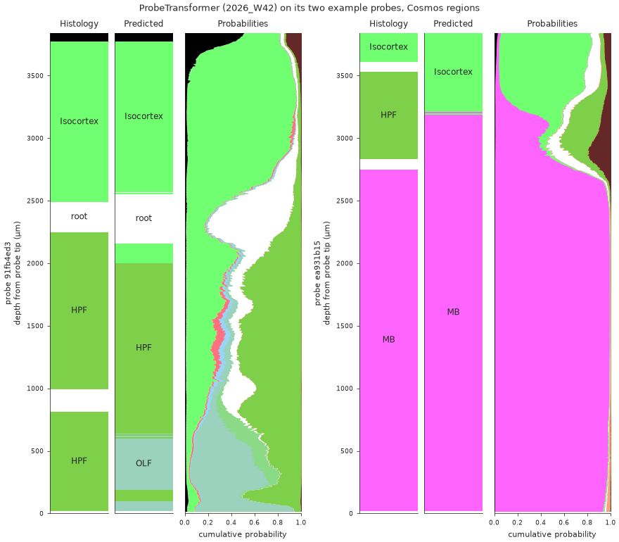
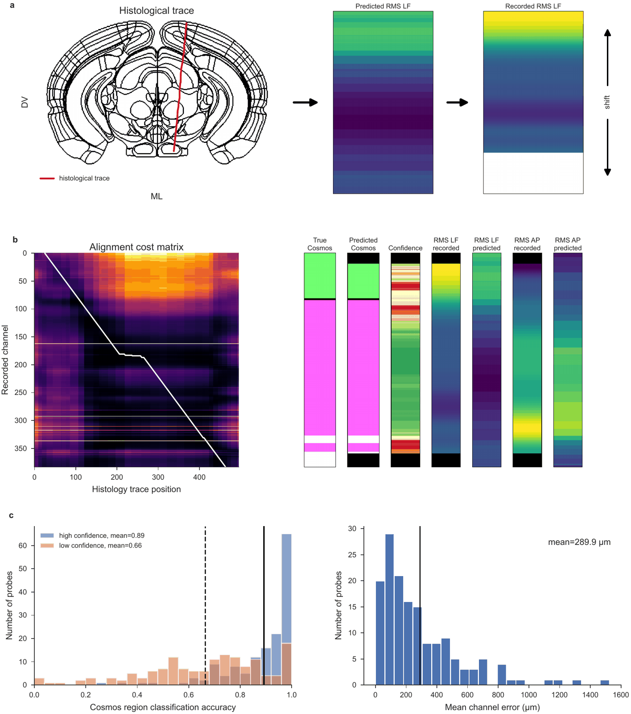
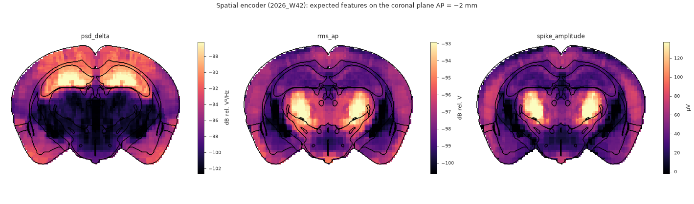
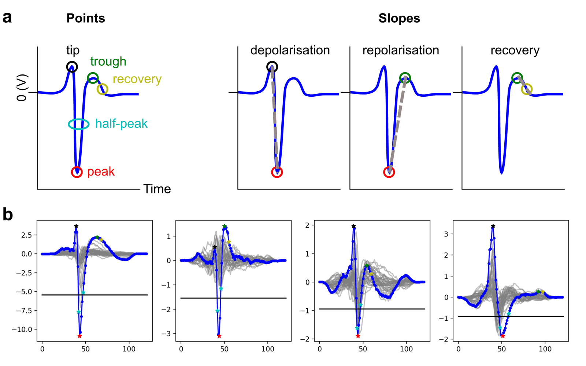
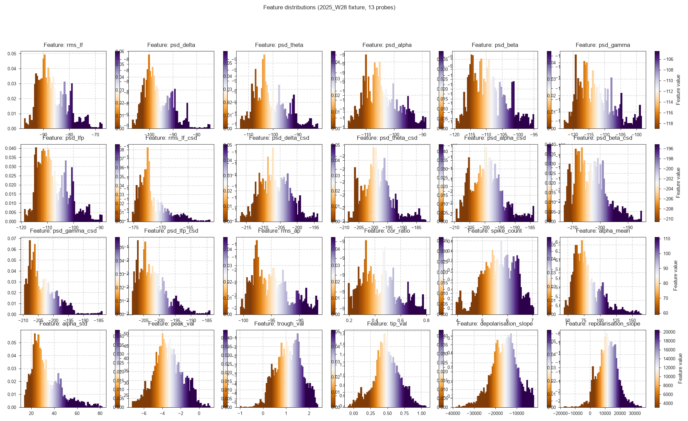
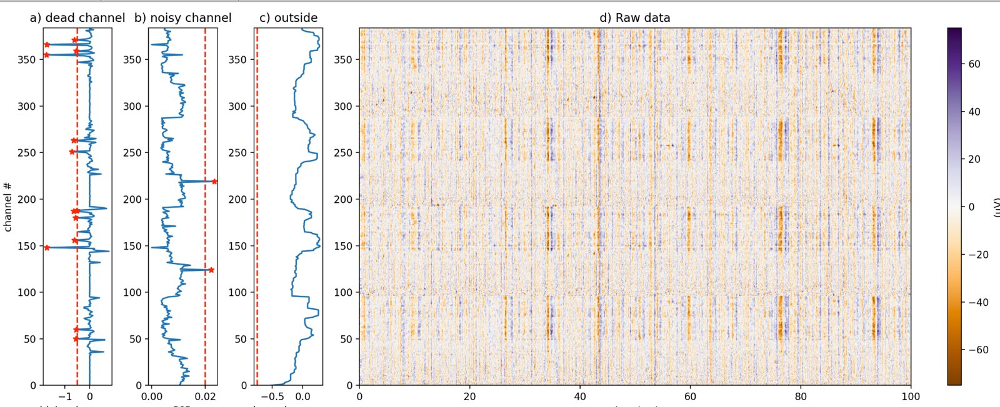
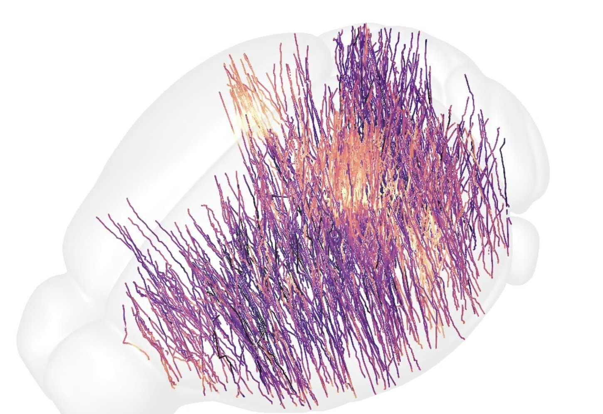

**ibleatools** turns a raw Neuropixels recording into a table of electrophysiological
features — one row per recording channel — and runs the published IBL Ephys Atlas models
over it to infer, for example, which brain region each channel sits in.

{.lightbox}

## What can I answer with it?

:::::: {.grid style="margin-bottom: 2rem;"}

::::: {.g-col-12 .g-col-md-6 .g-col-lg-4}
:::: {.card .h-100}
[{.card-img-top .nolightbox style="height:170px; object-fit:cover; object-position:left top;" fig-alt="Predicted regions along a probe"}](tutorials/where-is-my-probe.qmd)

::: {.card-body}
**[Which brain regions is my probe in?](tutorials/where-is-my-probe.qmd)**<br>
From your recording to a region per channel, step by step.
:::
::::
:::::

::::: {.g-col-12 .g-col-md-6 .g-col-lg-4}
:::: {.card .h-100}
[{.card-img-top .nolightbox style="height:170px; object-fit:cover; object-position:left top;" fig-alt="Alignment to the histology track"}](tutorials/where-is-my-probe.qmd#refine-with-histology)

::: {.card-body}
**[Does my histology agree with the electrophysiology?](tutorials/where-is-my-probe.qmd#refine-with-histology)**<br>
Place the channels on your traced track, in code or in the alignment GUI.
:::
::::
:::::

::::: {.g-col-12 .g-col-md-6 .g-col-lg-4}
:::: {.card .h-100}
[{.card-img-top .nolightbox style="height:170px; object-fit:cover; object-position:left top;" fig-alt="Expected features on a coronal section"}](visualise/atlas-maps.qmd)

::: {.card-body}
**[What should a channel record at a given position?](how-to/predict-features-from-position.qmd)**<br>
The spatial encoder's expected features, anywhere in the brain. [Maps](visualise/atlas-maps.qmd).
:::
::::
:::::

::::: {.g-col-12 .g-col-md-6 .g-col-lg-4}
:::: {.card .h-100}
[{.card-img-top .nolightbox style="height:170px; object-fit:cover; object-position:left top;" fig-alt="Waveform shape features"}](how-to/predict-unit-phenotypes.qmd)

::: {.card-body}
**[Which units and cell types should I expect there?](how-to/predict-unit-phenotypes.qmd)**<br>
The unit encoder's phenotypes and cell-type composition at a position.
:::
::::
:::::

::::: {.g-col-12 .g-col-md-6 .g-col-lg-4}
:::: {.card .h-100}
[{.card-img-top .nolightbox style="height:170px; object-fit:cover; object-position:left top;" fig-alt="Feature distributions"}](visualise/features-along-probe.qmd#feature-distributions-across-a-dataset)

::: {.card-body}
**[How does my recording compare with the IBL brain-wide data?](visualise/features-along-probe.qmd#feature-distributions-across-a-dataset)**<br>
Your features against the published ones. [Load them](how-to/load-channel-features.qmd).
:::
::::
:::::

::::: {.g-col-12 .g-col-md-6 .g-col-lg-4}
:::: {.card .h-100}
[{.card-img-top .nolightbox style="height:170px; object-fit:cover; object-position:left top;" fig-alt="Bad-channel detection"}](visualise/voltage-snippets.qmd)

::: {.card-body}
**[Is my recording healthy?](visualise/voltage-snippets.qmd)**<br>
Destriped voltage, bad channels and where the probe enters the brain.
:::
::::
:::::

::::::

Two things you can do with it, independently:

- **Compute features** from your own recording — local SpikeGLX files, NWB (including
  streamed DANDI assets), SpikeInterface Zarr stores, lfpack LFP archives, or an LF array
  already in memory.
- **Run a published model** downloaded from the Hugging Face Hub. The model repositories
  are public.

::: {.callout-note}
This package is imported as `ephysatlas`. It is **not** the same as the `ephys_atlas`
package (with an underscore) from the
[paper-ephys-atlas](https://github.com/int-brain-lab/paper-ephys-atlas) repository.
:::

## Install

ibleatools requires **Python 3.12 or newer**.

```bash
git clone https://github.com/int-brain-lab/ibleatools.git
cd ibleatools
pip install -e .
```

That is the **lite** install, and it is the default. It covers model download and
inference, LF / CSD / AP feature computation, aggregation and denoising, and data
download. It does **not** include spike/waveform feature computation, which needs
[DARTsort](https://github.com/cwindolf/dartsort):

```bash
pip install -e ".[full]"
```

See [lite vs full](explanation/install-variants.qmd) for which one you need.

## Quick start

Predict brain regions from a table of features, using the published whole-probe decoder
(ProbeTransformer):

```python
import pandas as pd
from ephysatlas import load_pretrained

# Public Hugging Face repo — no account or token needed. Pin the vintage.
model = load_pretrained(
    "int-brain-lab/ea-decoder-channel-transformer", revision="2026_W42"
)

# Check that this install reproduces the model's shipped output before trusting it
model.selftest()

# The model ships a small example, so this runs with no data of your own
sample = model.path_model / "example" / "features_sample.parquet"
out = model.predict(pd.read_parquet(sample))

print(out[["predicted_acronym", "prediction_probability", "seed_agreement"]].head())
```

Compute features from a local recording of your own, here SpikeGLX AP/LF files:

```python
from ephysatlas.feature_calculators import SpikeGLXFileFeatureCalculator

calc = SpikeGLXFileFeatureCalculator(
    ap_file="/data/probe00.ap.cbin", lf_file="/data/probe00.lf.cbin"
)
# Features on 5 snippets spread over the recording, aggregated per channel and denoised,
# as the published models expect. The spike features need the [full] install.
df = calc.compute_denoised_features(n_snippets=5, duration_ap=5.0, duration_lf=5.0)
print(df.index.names)   # ['pid', 'channel']
```

There are more ways to load a recording: NWB files (local, streamed or on DANDI),
SpikeInterface Zarr stores and lfpack archives. See the how-to guides for
[NWB](how-to/compute-features-nwb.qmd), [Zarr](how-to/compute-features-zarr.qmd) and
[lfpack](how-to/load-lfp-features.qmd#computing-features-from-the-archives).

Full walkthrough in the [tutorial](tutorials/first-predictions.qmd).

## Published models

| Hugging Face repo | Family | What it predicts | Vintage |
|---|---|---|---|
| [`int-brain-lab/ea-decoder-channel-xgboost`](https://huggingface.co/int-brain-lab/ea-decoder-channel-xgboost) | Region decoder | Brain region per channel, from features | `2026_W42` |
| [`int-brain-lab/ea-decoder-channel-transformer`](https://huggingface.co/int-brain-lab/ea-decoder-channel-transformer) | Whole-probe region decoder | Brain region per channel, from a whole probe's features | `2026_W42` |
| [`int-brain-lab/ea-encoder-channel`](https://huggingface.co/int-brain-lab/ea-encoder-channel) | Spatial encoder | Features per channel, from position | `2026_W42` |
| [`int-brain-lab/ea-encoder-unit`](https://huggingface.co/int-brain-lab/ea-encoder-unit) | Unit encoder | Unit phenotypes and cell-type composition, from position | `2026_W42` |

All four load through the same call, [`load_pretrained`](api/load_pretrained.qmd). The
encoders also drive probe alignment —
[`ephysatlas.alignment`](api/index.qmd#alignment) places a probe's channels in the brain,
with or without histology.

## Explore the atlas in your browser

::: {.callout-tip}
## IBL Ephys Atlas viewer

[ephys-atlas.iblcore.org](https://ephys-atlas.iblcore.org/) is a browser viewer for the
IBL Ephys Atlas and the brain-wide maps around it: the recorded features these models are
trained on, the predicted encoding volumes, gene expression atlases, the lipidome and
Brain-Wide Map task responses. All are registered to the Allen atlas, so you can compare
them slice by slice. It can also load a compatible dataset of your own, which stays in
your browser.
:::

{.lightbox width=50%}

## Documentation

| Page | Content |
|---|---|
| **Tutorials** | |
| [Your first brain-region predictions](tutorials/first-predictions.qmd) | Install, download a model and predict brain regions on its bundled example — start here |
| [Which brain regions is my probe in?](tutorials/where-is-my-probe.qmd) | The whole workflow, from your recording to an aligned probe |
| **How-to: compute features on your data** | |
| [SpikeGLX files](how-to/compute-features-spikeglx.qmd) | Compute features from local AP/LF `.bin` / `.cbin` files |
| [NWB](how-to/compute-features-nwb.qmd) | Compute features from a local, streamed or DANDI-hosted NWB file |
| [Zarr](how-to/compute-features-zarr.qmd) | Compute features from a SpikeInterface-native Zarr store |
| [Tune the computation](how-to/tune-feature-computation.qmd) | Single snippets, snippet windows, per-feature parameters, inspecting destriped data |
| [Aggregate and denoise](how-to/aggregate-and-denoise.qmd) | Turn per-snippet features into the table a model expects |
| **How-to: run published models** | |
| [Download a model](how-to/download-models.qmd) | `load_pretrained`, pinning a vintage, and the self-test |
| [Predict regions](how-to/predict-regions.qmd) | Run the region decoders and read their output |
| [Predict features from position](how-to/predict-features-from-position.qmd) | Run the spatial encoder — position in, features out |
| [Predict unit phenotypes](how-to/predict-unit-phenotypes.qmd) | Run the unit encoder — position in, unit phenotypes and cell types out |
| **How-to: load IBL atlas data** (needs an IBL account) | |
| [Channel features](how-to/load-channel-features.qmd) | Download the published IBL channel aggregates |
| [Cells features](how-to/load-cells-features.qmd) | The per-unit aggregates: cell tables, autocorrelograms, waveforms, stPC, stLFP |
| [Compressed LFP](how-to/load-lfp-features.qmd) | The whole-recording LFP of every insertion, from lfpack archives |
| [Encoding volumes](how-to/load-encoding-volume.qmd) | Features on a whole-brain voxel grid of the Allen CCF |
| [Leave out flagged insertions](how-to/exclude-flagged-insertions.qmd) | The automatic QC labels of every insertion, and the `exclude_pids` of the loaders |
| **Visualise** | |
| [Gallery](visualise/index.qmd) | Every figure of the site, with the page that draws it |
| [Features along the probe](visualise/features-along-probe.qmd) | How features vary with depth, beside the brain regions |
| [Region predictions](visualise/predictions-along-probe.qmd) | Predicted regions and their probabilities along the probe |
| [Raw and destriped voltage](visualise/voltage-snippets.qmd) | The voltage behind the features, and the bad channels |
| [Atlas maps](visualise/atlas-maps.qmd) | Features across the brain, on atlas slices |
| **Reference** | |
| [API](api/index.qmd) | Full API reference, generated from the docstrings |
| [Feature list](reference/feature-list.qmd) | Every feature column, its band and its units |
| [S3 layout](reference/s3-layout.qmd) | Where the IBL aggregates live, and how they are versioned |
| [Model manifest](reference/model-manifest.qmd) | The publication contract every model ships |
| **Explanation** | |
| [Core concepts](explanation/concepts.qmd) | Channels vs cells, vintages, projects, denoising, region maps |
| [Feature pipeline](explanation/feature-pipeline.qmd) | What happens between raw voltage and a feature table |
| [Model families](explanation/model-families.qmd) | Four model families, one load path |
| [Lite vs full](explanation/install-variants.qmd) | Which install you need, and why the split exists |

## The IBL ecosystem

ibleatools builds on, and feeds into, other International Brain Laboratory tools:

| tool | its role around ibleatools |
|---|---|
| [ONE](https://int-brain-lab.github.io/ONE/) | Data access: the public IBL recordings, and the atlas aggregates with an IBL account |
| [iblatlas](https://github.com/int-brain-lab/iblatlas) ([examples](https://docs.internationalbrainlab.org/atlas_examples.html)) | The Allen atlas in IBL coordinates: brain regions, the Beryl and Cosmos mappings, slice plots |
| [ibl-neuropixel](https://github.com/int-brain-lab/ibl-neuropixel) | `ibldsp` destriping and bad-channel detection, the `spikeglx` reader, probe geometry |
| [IBL alignment GUI](https://int-brain-lab.github.io/ibl-alignment-gui/) | Aligning a probe to its histology; its [Channel Prediction plugin](https://int-brain-lab.github.io/ibl-alignment-gui/channel_prediction.html) runs these models |
| [IBL Ephys Atlas viewer](https://ephys-atlas.iblcore.org/) | The atlas in the browser |
| [lfpack](https://github.com/int-brain-lab/lfpack) | Compressed LFP of the IBL recordings, readable by [an ibleatools calculator](how-to/load-lfp-features.qmd#computing-features-from-the-archives) |
| [DARTsort](https://github.com/cwindolf/dartsort) | Spike detection behind the waveform features (`[full]` install) |
| [IBL documentation](https://docs.internationalbrainlab.org/) | The public IBL data, how to load it, and the atlas notebooks |

## Getting help

Open an issue on [GitHub](https://github.com/int-brain-lab/ibleatools/issues).
Contributions are welcome — see
[CONTRIBUTING.md](https://github.com/int-brain-lab/ibleatools/blob/main/CONTRIBUTING.md).
