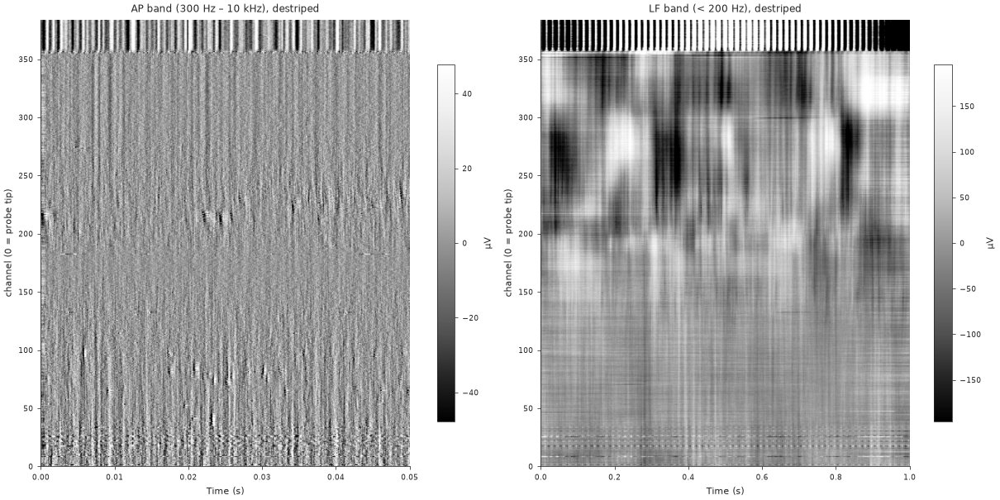
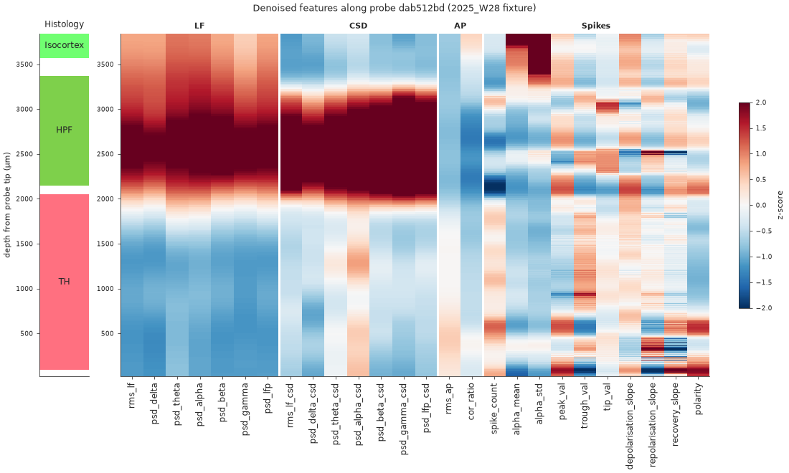
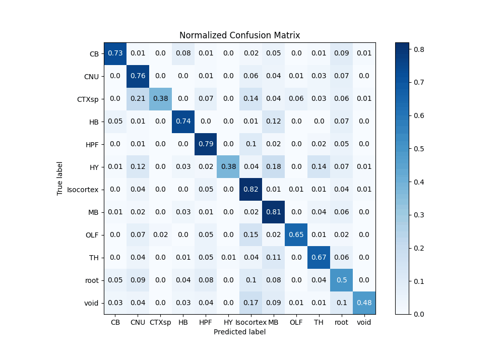
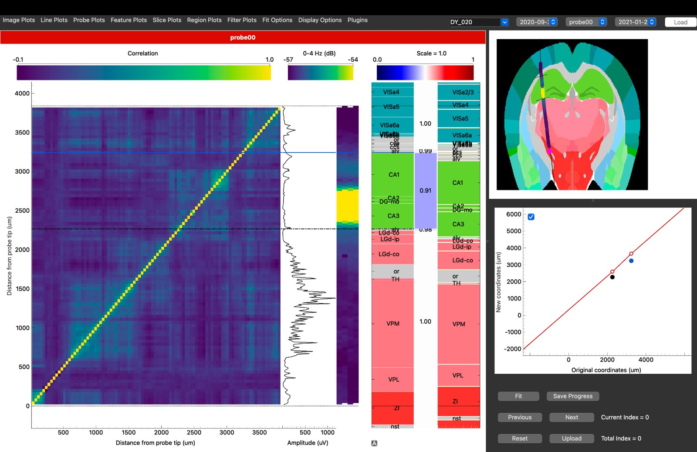

You have recorded with a Neuropixels probe and want to know where each channel was. This
tutorial is the whole journey, in seven steps. Each step is short and links to the page
that covers it in full.

{.lightbox}

| step | you get | details |
|---|---|---|
| [1. Look at the recording](#look-at-the-recording) | A first check of the voltage and the bad channels | [Raw and destriped voltage](../visualise/voltage-snippets.qmd) |
| [2. Compute features](#compute-features) | One row of features per channel | [SpikeGLX](../how-to/compute-features-spikeglx.qmd), [aggregate and denoise](../how-to/aggregate-and-denoise.qmd) |
| [3. Check the features](#check-the-features) | Features along depth, and their ranges | [Features along the probe](../visualise/features-along-probe.qmd) |
| [4. Predict the regions](#predict-the-regions) | A region per channel, from the ephys alone | [Predict brain regions](../how-to/predict-regions.qmd) |
| [5. Read the confidence](#read-the-confidence) | Which predictions to trust | [Region predictions along the probe](../visualise/predictions-along-probe.qmd) |
| [6. Refine with histology](#refine-with-histology) | The channels placed on your traced probe track | [IBL alignment GUI](https://int-brain-lab.github.io/ibl-alignment-gui/) |
| [7. Compare with the atlas](#compare-with-the-atlas) | What the atlas expected at those positions | [Atlas maps](../visualise/atlas-maps.qmd) |

## What you need

- A Neuropixels recording: the AP and LF bands as SpikeGLX `.bin` / `.cbin` files, an NWB
  file or a SpikeInterface Zarr store. LF only works too, with fewer features.
- ibleatools, installed as in the [first tutorial](first-predictions.qmd). For the spike
  features, the `[full]` install (DARTsort); see [lite vs full](../explanation/install-variants.qmd).
- Optional, for step 6: the probe track traced in your histology and registered to the
  Allen atlas, as an `xyz_picks.json` file (µm, relative to bregma). The alignment GUI's
  [data preparation](https://int-brain-lab.github.io/ibl-alignment-gui/data_preparation.html#preparing-trajectory-data)
  page shows how to write it from a [BrainGlobe](https://brainglobe.info/) brainreg
  segmentation or from Lasagna.

## 1. Look at the recording {#look-at-the-recording}

Before computing anything, look at a second of voltage. It tells you whether the probe
entered the brain, which channels are dead or noisy, and where the brain surface is.

```python
from ephysatlas.feature_calculators import SnippetWindow, SpikeGLXFileFeatureCalculator

calc = SpikeGLXFileFeatureCalculator(
    ap_file="/data/probe00/_spikeglx_ephysData_g0_t0.imec0.ap.cbin",
    lf_file="/data/probe00/_spikeglx_ephysData_g0_t0.imec0.lf.cbin",
    name="subject42_probe00",
)
snippet = calc.get_destriped_snippet(SnippetWindow(t_start=600.0, duration_ap=1.0, duration_lf=1.0))
```

{.lightbox}

[Raw and destriped voltage](../visualise/voltage-snippets.qmd) has the plotting code, the
destriping steps and how bad channels are labelled.

## 2. Compute features {#compute-features}

Each channel becomes one row of electrophysiological features: power in the LF bands, the
same on the current-source density, AP-band RMS, spike rate and waveform shape.

{.lightbox}

The published models were trained on features aggregated over several snippets spread
through the recording, then denoised along the probe. `compute_denoised_features` does all
of it:

```python
df = calc.compute_denoised_features(n_snippets=5, duration_ap=5.0, duration_lf=5.0)
df.to_parquet("/data/probe00/features.pqt")   # indexed by (pid, channel)
```

Spike detection dominates the feature computation time: allow minutes per snippet on a CPU, much less on a
GPU. `n_jobs=` computes the snippets in parallel. For NWB or Zarr data, use the matching
calculator: [NWB](../how-to/compute-features-nwb.qmd),
[Zarr](../how-to/compute-features-zarr.qmd). Why several snippets, and what
denoising does: [aggregate and denoise](../how-to/aggregate-and-denoise.qmd).

## 3. Check the features {#check-the-features}

Plot the features against depth. Region boundaries should show as changes across many
features at once; a feature that is flat, or wildly out of range, usually points to a
problem upstream.

{.lightbox}

Then compare their distributions with those of the training data. A units mistake, such as
raw volts where dB are expected, shows up as values far outside the training range. Both plots are in
[features along the probe](../visualise/features-along-probe.qmd).

## 4. Predict the regions {#predict-the-regions}

Two published decoders predict one of 13 Cosmos-level regions per channel. The XGBoost
decoder reads each channel alone; the ProbeTransformer reads the whole probe at once, so
each channel's call can use the channels above and below it.

```python
from ephysatlas import load_pretrained

df["outside"] = df["channel_labels"] == 3   # the one derived column the decoders need

xgb = load_pretrained("int-brain-lab/ea-decoder-channel-xgboost", revision="2026_W42")
out_xgb = xgb.predict(df)

transformer = load_pretrained("int-brain-lab/ea-decoder-channel-transformer", revision="2026_W42")
out = transformer.predict(df)

print(out["predicted_acronym"].value_counts())
```

On macOS, run the two decoders in separate processes or with `OMP_NUM_THREADS=1`: see
[troubleshooting](../how-to/predict-regions.qmd#troubleshooting). Run `selftest()` on each
model once after installing; see
[download a model](../how-to/download-models.qmd). The input requirements (units, the
`outside` column) and the outputs are in [predict brain regions](../how-to/predict-regions.qmd).

## 5. Read the confidence {#read-the-confidence}

A prediction comes with two kinds of uncertainty. `prediction_probability` is how sure the
model is of its winner; `fold_agreement` (XGBoost) or `seed_agreement` (ProbeTransformer)
is how often its ensemble members agree. Low agreement is the more serious warning.

Plot the full posterior along depth, as at the top of this page, to see where the model
hesitates and between which regions. Some regions are easier than others: Isocortex,
midbrain and hippocampus are usually right, while the cortical subplate (CTXsp) and
hypothalamus (HY) are often confused with their neighbours.

{.lightbox width=70%}

Plotting code: [region predictions along the probe](../visualise/predictions-along-probe.qmd).

## 6. Refine with histology {#refine-with-histology}

The decoders use the electrophysiology alone. If you traced the probe in your histology,
you can do better: place the channels along that track, where their features best match
what the atlas expects there. The spatial encoder predicts the features along the track,
and dynamic time warping matches the recorded features to them.

![Automatic alignment. (a) The histology trace gives positions; the spatial encoder predicts the features expected along it (here RMS LF), which are offset from the recorded ones. (b) The cost of matching each recorded channel to each trace position, with the warping path (white), and the result: Cosmos regions from the reference alignment and from the automatic one, its confidence, and the recorded against predicted features. (c) Over held-out probes: region accuracy, higher when the alignment is confident, and the mean error per channel.](../figures/auto_alignment.png){.lightbox}

### Interactively, in the alignment GUI

The [IBL alignment GUI](https://int-brain-lab.github.io/ibl-alignment-gui/) shows your
features beside the histology and lets you align the probe by hand, region boundary by
region boundary. Its
[Channel Prediction plugin](https://int-brain-lab.github.io/ibl-alignment-gui/channel_prediction.html)
runs the decoders and the automatic alignment on the feature table from step 2. Point the
GUI at it with a `features` dataset in the session YAML, or with
*Plugins → Channel Prediction → Load features file…*. The
[data preparation](https://int-brain-lab.github.io/ibl-alignment-gui/data_preparation.html)
page lists the other files it needs.

{.lightbox}

### In code

`ephysatlas.alignment` is the same alignment without the GUI:

```python
import json

import numpy as np
from iblatlas.atlas import AllenAtlas
from ephysatlas.alignment import ChannelModel, align_histology, plot_alignment_result
from ephysatlas.alignment.geometry import (
    extend_trace_to_brain, order_top_to_bottom, region_ids, resample_curve,
)

ba = AllenAtlas(res_um=25)    # downloads the Allen volumes on first use
model = ChannelModel()        # the spatial encoder, at the alignment's default vintage

# Recorded features, one row per channel, top of the probe first
pid = df.index.get_level_values("pid")[0]
d = df.loc[pid].sort_values("axial_um", ascending=False)
recorded = d[model.features].to_numpy(np.float32)
recorded[~np.isfinite(recorded)] = 0.0

# The traced track: xyz_picks.json is in µm, relative to bregma; the alignment wants metres,
# sampled every 10 µm from top to bottom and extended to the brain surface
picks = np.array(json.load(open("/data/probe00/xyz_picks.json"))["xyz_picks"]) / 1e6
trace = extend_trace_to_brain(order_top_to_bottom(resample_curve(picks, step_um=10)), ba)

result = align_histology(model, recorded, trace, pid=pid)
fig = plot_alignment_result(result, ba)

# A Cosmos region per channel, top of the probe first
cosmos_id = ba.regions.id[region_ids(ba, result.channel_xyz, mapping="Cosmos")]
```

`result.channel_xyz` is the estimated position of every channel (metres) and
`result.p_good` the confidence along the probe. Without histology,
`ephysatlas.alignment.localize_ephys_only` searches the brain for the trajectory that best
explains the recording. All three methods are in the [alignment API](../api/index.qmd#alignment).

For atlas coordinates, mappings and slices, see the IBL notebooks on
[working with the atlas](https://docs.internationalbrainlab.org/notebooks_external/atlas_working_with_ibllib_atlas.html)
and [atlas mapping](https://docs.internationalbrainlab.org/notebooks_external/atlas_mapping.html).

## 7. Compare with the atlas {#compare-with-the-atlas}

Once the channels have positions, the spatial encoder says what a channel at each of them
*should* record. A stretch of probe whose recorded features stay far from that expectation
is either unusual tissue or still misplaced:

```python
encoder = load_pretrained("int-brain-lab/ea-encoder-channel", revision="2026_W42")
expected = encoder.predict_xyz(result.channel_xyz, pids=pid)   # (384, 43), metres in
```

See [predict features from position](../how-to/predict-features-from-position.qmd#comparing-prediction-against-reality).
To browse the atlas around your probe, open the
[IBL Ephys Atlas viewer](https://ephys-atlas.iblcore.org/): every feature on linked brain
slices, in the browser. It can also load a compatible dataset of your own.

 has the code.](../figures/encoder_coronal_maps.png){.lightbox}

## Where next

- [Core concepts](../explanation/concepts.qmd) — vintages, and why features and models
  must match
- [Model families](../explanation/model-families.qmd) — the decoders and encoders behind
  steps 4 to 7
- [The feature pipeline](../explanation/feature-pipeline.qmd) — what step 2 does,
  in detail
- [Visualise](../visualise/index.qmd) — every figure, with its code
