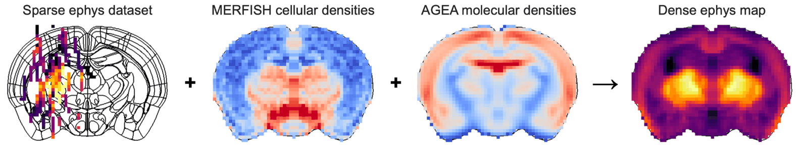
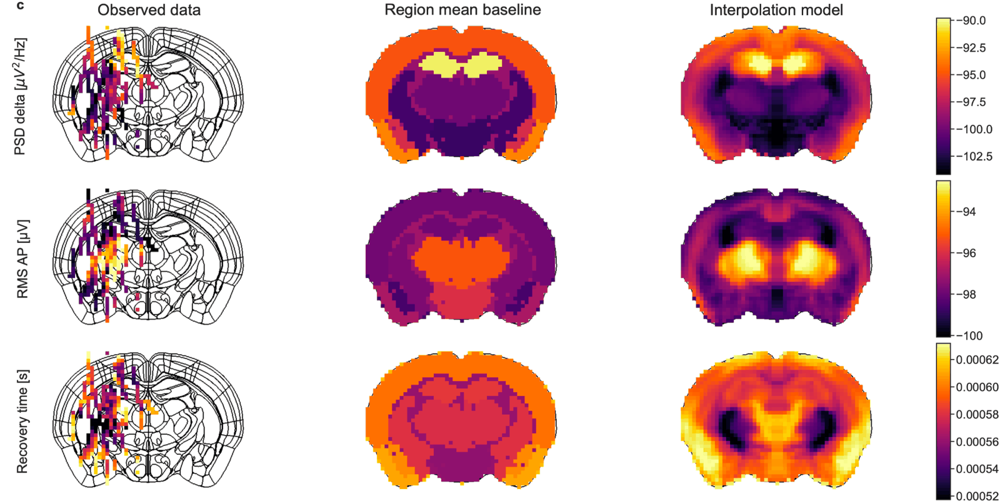

Down one probe, features change at region boundaries. Across the brain they form a map:
what a channel at any position *should* record. ibleatools gives you that map two ways,
from the spatial encoder (public) or from the published encoding volumes (IBL account).
The [IBL Ephys Atlas viewer](https://ephys-atlas.iblcore.org/) shows it in the browser.

::: {.callout-tip}
## Explore it in your browser first

[ephys-atlas.iblcore.org](https://ephys-atlas.iblcore.org/) is a browser viewer for the
atlas and the brain-wide maps around it: the recorded features, the predicted encoding
volumes, gene expression atlases, the lipidome and Brain-Wide Map task responses. All are
registered to the Allen atlas, so you can compare them slice by slice. It can also load a
compatible dataset of your own, which stays in your browser. Its
[user guide](https://ephys-atlas.iblcore.org/app/#help) explains the views.
:::

## From sparse recordings to a dense map

The recordings sample the brain sparsely, along probe tracks. The spatial encoder fills
the space between them from two sources: the recorded channels nearby, on other probes,
and the molecular context at the position (MERFISH cell-type densities and AGEA gene
expression from the Allen Institute).

{.lightbox}

A dense map is more than a per-region average. Within a region the features vary, and the
model keeps that variation:

{.lightbox}

## A coronal map from the spatial encoder

No account needed: the encoder is public, and `iblatlas` provides the brain mask and the
region outlines. Predict every voxel of one coronal plane, then draw it:

```python
from iblatlas.atlas import AllenAtlas
import ephysatlas.plots
from ephysatlas import load_pretrained

ba = AllenAtlas(res_um=25)   # downloads the Allen volumes on first use
encoder = load_pretrained("int-brain-lab/ea-encoder-channel", revision="2026_W44")

# Every 4th voxel (100 µm) of the coronal plane at AP = -2 mm, inside the brain
fig, axs = ephysatlas.plots.figure_encoder_coronal(
    encoder,
    ["psd_delta", "rms_ap", "spike_amplitude"],
    ap_m=-2000e-6,                       # metres from bregma
    brain_atlas=ba,
    scales={"spike_amplitude": 1e6},     # volts -> µV
    units={"psd_delta": "dB rel. V²/Hz", "rms_ap": "dB rel. V", "spike_amplitude": "µV"},
)
```

That is about 6,000 positions, predicted in seconds, in one call to
`encoder.predict_xyz`.

{.lightbox}

`step` sets the spacing of the predicted voxels and `percentiles` the colour range of each
panel (2 % to 98 % of its values by default). `show_boundaries`, `show_colorbar` and
`show_titles` turn those parts off. `examples/plot_encoder_maps.py` draws this figure.

Coordinates are in **metres**, in the IBL bregma-centred space of `iblatlas`, as everywhere
in ibleatools. See [predict features from position](../how-to/predict-features-from-position.qmd)
for the encoder itself, and the IBL notebook
[working with the atlas](https://docs.internationalbrainlab.org/notebooks_external/atlas_working_with_ibllib_atlas.html)
for slices and coordinates.

## The published encoding volumes

With an IBL account, the encoding volume of each vintage is the same map precomputed on a
regular grid, every feature at once. [Load encoding volumes](../how-to/load-encoding-volume.qmd)
covers the download and the file. Its axes are ML × AP × DV; transposed to AP × ML × DV it
has exactly the shape of `AllenAtlas(res_um)`, so the iblatlas slice plots take it as is:

```python
import numpy as np
from iblatlas.atlas import AllenAtlas
from iblatlas.plots import plot_volume_on_slice

res_um = int(data["res_um"][0])
idx = np.where(data["feature_names"] == "rms_ap")[0][0]
volume = np.transpose(data["ephys_atlas_vol"][..., idx], (1, 0, 2)).astype(float)
volume[volume == 0] = np.nan                   # 0 is outside the brain mask

plot_volume_on_slice(volume, coord=-2000, slice="coronal", mapping="Cosmos",
                     cmap="magma", brain_atlas=AllenAtlas(res_um=res_um))
```

`coord` is in µm here. The [ephys edges](../how-to/load-encoding-volume.qmd#ephys-edges) of
a volume, where the signature changes fastest, plot the same way.

For values that are one number per region rather than per voxel, iblatlas also draws
[region values on slices](https://docs.internationalbrainlab.org/notebooks_external/atlas_plotting_scalar_on_slice.html)
and on the
[Swanson flat map](https://docs.internationalbrainlab.org/notebooks_external/atlas_swanson_flatmap.html).

## Next steps

- [Predict features from position](../how-to/predict-features-from-position.qmd) — the
  encoder, and comparing it against a recording
- [Load encoding volumes](../how-to/load-encoding-volume.qmd) — the precomputed maps
- [Model families](../explanation/model-families.qmd) — how the encoder works
