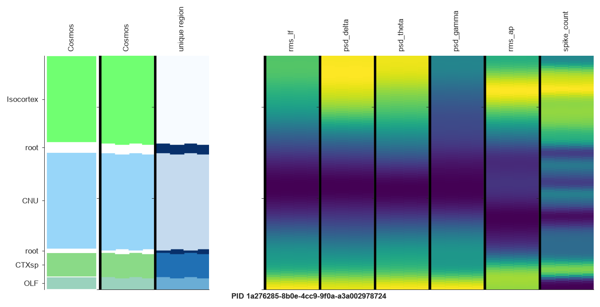
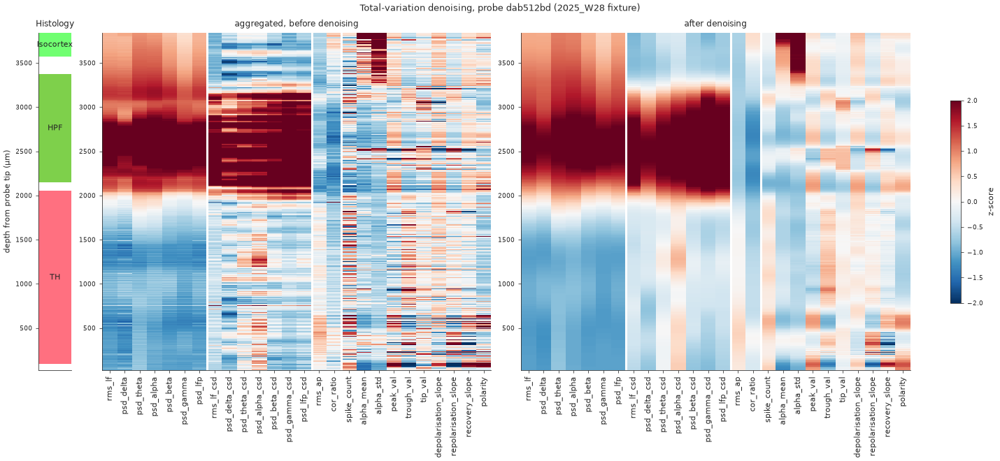

Most of what ibleatools computes is best read as a picture: features against depth beside
the brain regions, region predictions with their uncertainty, voltage before and after
destriping, maps across the brain. Each card below links to the page with the code that
draws it.

:::::: {.grid style="margin-bottom: 2rem;"}

::::: {.g-col-12 .g-col-md-6 .g-col-lg-4}
:::: {.card .h-100}
[{.card-img-top .nolightbox style="height:190px; object-fit:cover; object-position:left top;" fig-alt="Z-scored features along a probe"}](features-along-probe.qmd#all-features-as-one-heatmap)

::: {.card-body}
**[Features along the probe](features-along-probe.qmd#all-features-as-one-heatmap)** 
Every feature of a probe against depth, beside the histology.
:::
::::
:::::

::::: {.g-col-12 .g-col-md-6 .g-col-lg-4}
:::: {.card .h-100}
[{.card-img-top .nolightbox style="height:190px; object-fit:cover; object-position:left top;" fig-alt="Feature strips down one probe"}](features-along-probe.qmd#features-down-one-probe)

::: {.card-body}
**[Feature strips on the probe geometry](features-along-probe.qmd#features-down-one-probe)** 
A few features drawn on the channel layout, region colours alongside.
:::
::::
:::::

::::: {.g-col-12 .g-col-md-6 .g-col-lg-4}
:::: {.card .h-100}
[{.card-img-top .nolightbox style="height:190px; object-fit:cover; object-position:left top;" fig-alt="Features before and after denoising"}](features-along-probe.qmd#before-and-after-denoising)

::: {.card-body}
**[Before and after denoising](features-along-probe.qmd#before-and-after-denoising)** 
What the total-variation filter removes, and the boundaries it keeps.
:::
::::
:::::

::::: {.g-col-12 .g-col-md-6 .g-col-lg-4}
:::: {.card .h-100}
[{.card-img-top .nolightbox style="height:190px; object-fit:cover; object-position:left top;" fig-alt="Region predictions along two probes"}](predictions-along-probe.qmd)

::: {.card-body}
**[Region predictions along the probe](predictions-along-probe.qmd)** 
Histology, predicted region and the full posterior, against depth.
:::
::::
:::::

::::: {.g-col-12 .g-col-md-6 .g-col-lg-4}
:::: {.card .h-100}
[{.card-img-top .nolightbox style="height:190px; object-fit:cover; object-position:left top;" fig-alt="Feature distributions across a dataset"}](features-along-probe.qmd#feature-distributions-across-a-dataset)

::: {.card-body}
**[Feature distributions](features-along-probe.qmd#feature-distributions-across-a-dataset)** 
The first check when a model behaves oddly on your data.
:::
::::
:::::

::::: {.g-col-12 .g-col-md-6 .g-col-lg-4}
:::: {.card .h-100}
[{.card-img-top .nolightbox style="height:190px; object-fit:cover; object-position:left top;" fig-alt="Destriped AP and LF voltage"}](voltage-snippets.qmd)

::: {.card-body}
**[Raw and destriped voltage](voltage-snippets.qmd)** 
The AP and LF snippets the features are computed on.
:::
::::
:::::

::::: {.g-col-12 .g-col-md-6 .g-col-lg-4}
:::: {.card .h-100}
[{.card-img-top .nolightbox style="height:190px; object-fit:cover; object-position:left top;" fig-alt="Bad-channel detection"}](voltage-snippets.qmd#bad-channels)

::: {.card-body}
**[Bad channels](voltage-snippets.qmd#bad-channels)** 
Why a channel is labelled dead, noisy or outside the brain.
:::
::::
:::::

::::: {.g-col-12 .g-col-md-6 .g-col-lg-4}
:::: {.card .h-100}
[{.card-img-top .nolightbox style="height:190px; object-fit:cover; object-position:left top;" fig-alt="Predicted features on a coronal section"}](atlas-maps.qmd)

::: {.card-body}
**[Atlas maps](atlas-maps.qmd)** 
What a channel at any position should record, on atlas slices.
:::
::::
:::::

::::: {.g-col-12 .g-col-md-6 .g-col-lg-4}
:::: {.card .h-100}
[{.card-img-top .nolightbox style="height:190px; object-fit:cover; object-position:left top;" fig-alt="Automatic alignment to histology"}](../tutorials/where-is-my-probe.qmd#refine-with-histology)

::: {.card-body}
**[Alignment to histology](../tutorials/where-is-my-probe.qmd#refine-with-histology)** 
Recorded against predicted features along the histology track.
:::
::::
:::::

::::::

## In the browser and in the GUI

Two IBL tools show the same data interactively:

- [**IBL Ephys Atlas viewer**](https://ephys-atlas.iblcore.org/) — the atlas, the
  predicted encoding volumes, gene expression atlases and the lipidome on linked brain
  slices, in the browser. It can also show a dataset of your own next to it.
- [**IBL alignment GUI**](https://int-brain-lab.github.io/ibl-alignment-gui/) — one probe at
  a time, features beside the histology, for aligning the probe. Its
  [Channel Prediction plugin](https://int-brain-lab.github.io/ibl-alignment-gui/channel_prediction.html)
  reads ibleatools features and adds the decoders' predictions.
