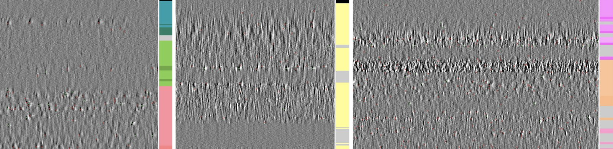

Every feature is computed from a few seconds of voltage. Looking at that voltage first is
the quickest check of a recording: whether the probe entered the brain, which channels are
dead or noisy, whether destriping behaved. It is also the most direct view of why the atlas
works at all: different brain regions *look* different.

{.lightbox}

## A destriped snippet

`get_destriped_snippet` reads one window and runs the same destriping as feature
computation, without computing any feature. See
[tune the computation](../how-to/tune-feature-computation.qmd#inspecting-the-destriped-data)
for its fields:

`figure_voltage_snippets` draws each one as an image, channels × time:

```python
import ephysatlas.plots
from ephysatlas.feature_calculators import SnippetWindow, SpikeGLXFileFeatureCalculator

calc = SpikeGLXFileFeatureCalculator(
    ap_file="/data/probe00.ap.cbin", lf_file="/data/probe00.lf.cbin"
)
snippet = calc.get_destriped_snippet(
    SnippetWindow(t_start=300.0, duration_ap=1.0, duration_lf=1.0)
)
fs_ap, fs_lf = snippet.raw.fs_ap, snippet.raw.fs_lf

fig, axs = ephysatlas.plots.figure_voltage_snippets({
    "AP band, destriped": (snippet.des_ap[:, : int(0.05 * fs_ap)], fs_ap),  # 50 ms shows single spikes
    "LF band, destriped": (snippet.des_lf, fs_lf),  # the LF needs the whole second
})
```

{.lightbox}

By default each panel's colour range is ±4 times its median channel standard deviation:
set on the typical channel rather than on the extremes, because the channels outside the
brain are many times larger and would grey out everything else. Pass `vrange` (in µV) to
use one range for every panel. `show_colorbar` and `show_titles` turn those parts off.
`examples/plot_voltage_snippets.py` draws this figure from the committed snippet.

## Raw against destriped

Neuropixels voltage carries artefacts shared across channels: common-mode noise, and
stripes from the multiplexed ADCs that sample channel groups at slightly different times.
Destriping removes them before any feature is computed. It is
`ibldsp.voltage.destripe` (AP) and `destripe_lfp` (LF) from
[ibl-neuropixel](https://github.com/int-brain-lab/ibl-neuropixel), called through
`ephysatlas.feature_computation.destripe_ap_lf`.

{.lightbox}

To check the destriping of your own recording, draw the raw AP beside the destriped AP (or
the LF pair) with the same function:

```python
n = int(0.05 * fs_ap)   # 50 ms
fig, axs = ephysatlas.plots.figure_voltage_snippets({
    "AP, raw": (snippet.raw.raw_ap[:, :n], fs_ap),
    "AP, destriped": (snippet.des_ap[:, :n], fs_ap),
})
```

`get_destriped_snippet` takes a `DestripeOptions` to try other destriping settings on the
inspection alone.

## Bad channels

Destriping needs to know which channels to leave out. Each channel is labelled from the raw
AP band: `0` good, `1` dead, `2` noisy, `3` outside the brain. The labels travel on as the
`channel_labels` feature column, and `outside` is derived from them.

{.lightbox}

The same figure for your own recording is one call:

```python
import numpy as np
from ibldsp.voltage import detect_bad_channels

labels, xfeats = detect_bad_channels(
    snippet.raw.raw_ap, fs=snippet.raw.fs_ap, display=True
)
print(np.bincount(labels.astype(int), minlength=4))   # good, dead, noisy, outside
```

`snippet.channel_labels` holds the labels feature computation actually used: those of the
channel table when the source has one, detected from the snippet otherwise.

## For IBL insertions

`ephysatlas.reveal.AtlasReveal` draws these views for any IBL probe insertion, given ONE
access: `figure_04_ap_voltage` (raw and destriped AP), `figure_05_lfp_voltage` (LF and its
current-source density) and `figure_06_bad_channels`.

```python
from one.api import ONE
from ephysatlas.reveal import AtlasReveal

reveal = AtlasReveal(one=ONE(), pid="0228bcfd-632e-49bd-acd4-c334cf9213e9")
reveal.figure_04_ap_voltage()
```

The IBL documentation shows how to
[load raw ephys data](https://docs.internationalbrainlab.org/notebooks_external/loading_raw_ephys_data.html)
of any public insertion yourself.

## Next steps

- [Compute features](../how-to/compute-features-spikeglx.qmd) from the recording you just
  checked
- [The feature pipeline](../explanation/feature-pipeline.qmd) — what happens after
  destriping
- [Features along the probe](features-along-probe.qmd) — the features this voltage turns
  into
